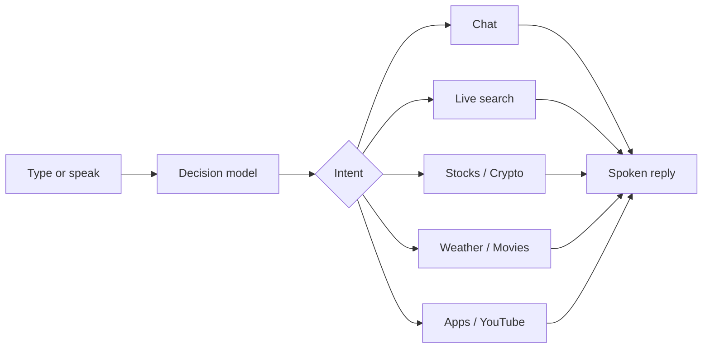

<div align="center">

# JARVIS

### A desktop AI assistant that listens, decides, and answers out loud.

A dark, animated Windows companion for conversation, live search, markets, weather, movies, YouTube, and local apps powered by Groq and spoken with a neural voice.

<br>

[](https://www.python.org/)
[](https://www.microsoft.com/windows)
[](https://groq.com/)
[](#interface)

<br>

`Standby` · `Listening` · `Thinking` · `Speaking`

</div>

---

## Overview

Jarvis is a personal desktop assistant with a chat window and a living status orb. You type or speak. A decision model classifies the request, a specialist service gathers the answer, and Edge TTS reads it back.

The interface stays in one of four states — standby, listening, thinking, speaking — so you always know what the assistant is doing.

---

## Capabilities

| | Capability | What you can ask | Source |
|---|---|---|---|
| 💬 | **Conversation** | Explanations, writing, math, the current time | Groq, with a short memory |
| 🌐 | **Live search** | News, people, anything that needs today’s facts | DuckDuckGo, summarized by Groq |
| 📈 | **Stocks** | “How is Apple doing today?” | Alpha Vantage |
| ₿ | **Crypto** | “What’s the price of Bitcoin?” | CoinGecko |
| 🌤 | **Weather** | “Weather in Dhaka” | Open-Meteo |
| 🎬 | **Movies & TV** | Ratings, cast, release details | TMDB |
| ▶️ | **YouTube** | “Search machine learning on YouTube” | Opens the top result |
| 🚀 | **App control** | “Open Chrome” · “Close Notepad” | Installed Windows apps |
| 🎙 | **Voice** | Mic button to dictate, neural voice to reply | Chrome Web Speech + Edge TTS |

The orb and task badge update as each request moves from thinking to speaking.

---

## How a request moves



`services/brain.py` never answers the question itself. It labels the intent — `general`, `realtime`, `stocks`, `crypto`, `weather`, `movies`, `open`, `close`, `youtube search` — and `route()` hands the text to the matching service. Several intents can be returned in one line, so a single sentence can open an app and ask a question.

---

## Interface

The window is a two-pane desktop app.

- **Left** — animated orb, live status, and a capability list
- **Right** — conversation, typing indicator, text field, send, and microphone

| State | Orb | Meaning |
|---|---|---|
| Standby | Soft blue pulse | Waiting |
| Listening | Cyan rings | Microphone is open |
| Thinking | Purple orbit | Classifying and fetching |
| Speaking | Waveform bars | Reading the reply |

---

## Try these

```text
How are you?
What's the time?
Who is the prime minister of Bangladesh?
Weather in Dhaka
What is Apple's stock price?
What is the price of Bitcoin?
What is the rating of Inception?
Search machine learning on YouTube
Open Chrome
Close Notepad
Bye Jarvis
```

---

## Quick start

**Requirements**

- Windows
- Python 3.13 or newer
- A microphone, if you want voice input
- Google Chrome, used by the speech recognizer
- A [Groq API key](https://console.groq.com/)

**Install**

```powershell
git clone https://github.com/Astr4n0x/PersonalAI
cd AI
python -m venv .venv
.\.venv\Scripts\Activate.ps1
pip install -r requirements.txt
```

**Configure**

Create a `.env` file in the project root:

```env
Username=your_name
AssistantName=your_assistant_name
GroqAPIkey=your_groq_api_key
AI_model=llama-3.3-70b-versatile
AI_voice=en-US-AndrewNeural

ALPHAVANTAGE_API_KEY=your_alpha_vantage_key
TMDB_API_TOKEN=your_tmdb_read_token
```

| Variable | Required | Used for |
|---|---|---|
| `GroqAPIkey` | Yes | Every language-model call |
| `AI_model` | Yes | Groq model id |
| `Username` | Yes | How the assistant addresses you |
| `AssistantName` | Yes | The assistant’s name in chat |
| `AI_voice` | No | Edge neural voice. Defaults to `en-US-AndrewNeural` |
| `ALPHAVANTAGE_API_KEY` | For stocks | [Alpha Vantage](https://www.alphavantage.co/support/#api-key) global quotes |
| `TMDB_API_TOKEN` | For movies | [TMDB](https://www.themoviedb.org/settings/api) v4 read access token |

Weather and crypto use public endpoints and do not need keys.

**Run**

```powershell
python main.py
```

Type in the field and press Enter, or press the microphone and speak. Say goodbye and Jarvis exits the turn cleanly.

---

## Project layout

```text
AI/
├── main.py                  # Window, threading, and the request loop
├── gui.py                   # Orb, chat, status, and input
├── requirements.txt
├── .env                     # Local secrets — never commit this
├── services/
│   ├── brain.py             # Intent classification and routing
│   ├── chatbot.py           # General conversation and memory
│   ├── realtime.py          # Web search and summary
│   ├── stocks.py            # Equity quotes
│   ├── crypto.py            # Coin prices
│   ├── weather.py           # Forecasts
│   ├── movies.py            # Films and series
│   ├── youtube.py           # Search and open
│   ├── open_apps.py         # Launch and close apps
│   ├── text_to_speach.py    # Neural speech
│   ├── speach_rec.py        # Microphone capture
│   └── news.py              # GDELT headlines
└── database/
    ├── chatHistory.json
    └── weather.json
```

---

## Stack

| Layer | Choice |
|---|---|
| Language | Python |
| Interface | Tkinter, custom-drawn orb at ~30 fps |
| Reasoning | Groq chat completions |
| Search | `ddgs` |
| Markets | Alpha Vantage, CoinGecko |
| Weather | Open-Meteo geocoding and forecast |
| Film data | TMDB |
| Speech out | `edge-tts` rendered to `voice.mp3`, played with Pygame |
| Speech in | Chrome Web Speech API, driven by Selenium |
| Desktop control | AppOpener |

Chat keeps a short rolling context and a small answer cache so repeated questions return immediately. The GUI and the brain talk through a queue, so network calls never freeze the window.

---

## Voice

Any [Microsoft Edge neural voice](https://github.com/rany2/edge-tts) id works in `AI_voice`. A few that fit this assistant:

| Voice | Character |
|---|---|
| `en-US-AndrewNeural` | Calm, default |
| `en-GB-RyanNeural` | British, measured |
| `en-US-GuyNeural` | Neutral, clear |

The microphone opens Chrome, allows the mic, and returns the final transcript to the same pipeline as typed text.

---

## Notes

- Keep `.env` off git. It holds API keys.
- Stock quotes follow Alpha Vantage’s free-tier rate limit.
- App open and close match the closest installed Windows application name.
- YouTube opens the first result in Firefox when it is available, otherwise the system browser.
- Image generation, reminders, system volume, and free-form “write this for me” intents are recognized by the decision prompt and are not wired through `route()` yet.

---

<div align="center">

Built as a personal AI workspace on Windows.

**Jarvis** — standby until you speak.

</div>
